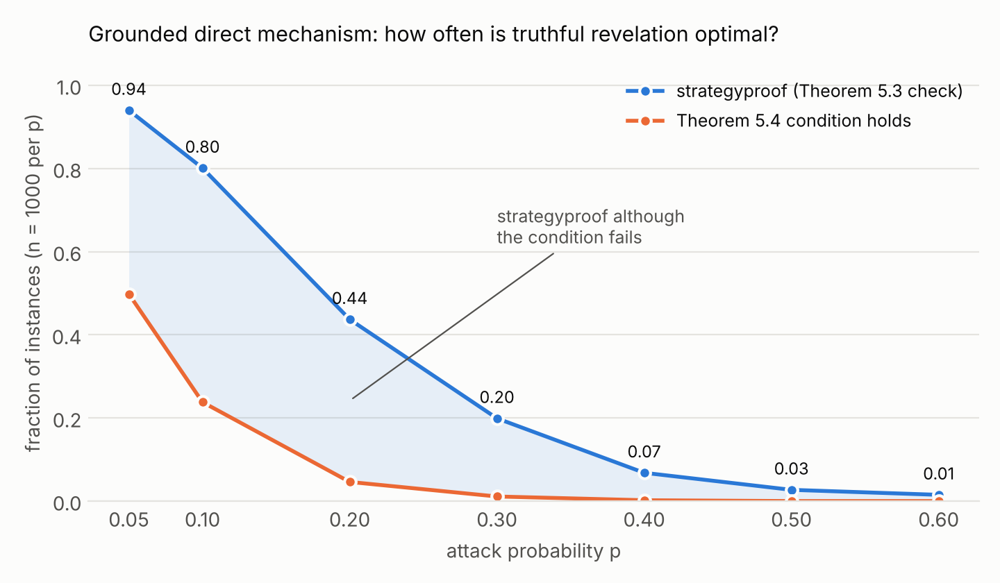

# Report: Argumentation Engine and Strategic Argumentation

## 1. Overview

This project implements Dung's abstract argumentation frameworks (AFs) in Python and uses them to study strategic behaviour in
argumentation, following Chapter 5 ("Argumentation among Agents", I. Rahwan) of *Multiagent Systems*, 2nd ed., G. Weiss (ed.),
MIT Press, 2013.

* `af.py` is an argumentation engine: conflict-freeness, defence, the characteristic function, admissible and complete sets, the
  grounded, complete, preferred, stable and semi-stable extensions, all legal labellings, and the acceptance status of an
  argument. It is tested on every example graph of the chapter.
* `strategic.py` implements the grounded direct argumentation mechanism. Each agent reveals a subset of its arguments, the
  mechanism returns the grounded extension of the graph induced by the revealed arguments, and an agent's utility is the number
  of its own arguments accepted. The module finds best responses and checks, exhaustively, when revealing everything is optimal
  (Theorem 5.3) and whether the graph-theoretic condition of Theorem 5.4 holds.
* `experiments.py` generates thousands of random instances and compares the two checks.

Section 2 gives the definitions, Section 3 the design and algorithms, Section 4 the engine's results on the book's examples,
Section 5 the strategic examples of the book, Section 6 the experiments and their analysis, Section 7 the testing.

## 2. Definitions

An AF is ⟨A, ⇀⟩ with A a finite set of arguments and ⇀ ⊆ A × A a defeat (attack) relation. For S ⊆ A let
S⁺ = {β : α ⇀ β for some α ∈ S}, α⁻ = {β : β ⇀ α} and range(S) = S ∪ S⁺.

| Notion | Book | Definition |
|---|---|---|
| Argumentation framework | Def. 5.1 | ⟨A, ⇀⟩ with A finite, ⇀ ⊆ A × A |
| Conflict-free | Def. 5.2 | S ∩ S⁺ = ∅ |
| Defended | Def. 5.2 | S defends α iff α⁻ ⊆ S⁺ |
| Characteristic function | Def. 5.3 | F(S) = {α ∈ A : S defends α} |
| Admissible | Def. 5.4 | S conflict-free and S ⊆ F(S) |
| Complete | Def. 5.5 | S conflict-free and S = F(S) |
| Labelling | Def. 5.6 | in ⇔ all defeaters out; out ⇔ some defeater in; undec otherwise |
| Grounded | Def. 5.7 | minimal complete extension = least fixed point of F |
| Preferred | Def. 5.7 | maximal complete extension = maximal admissible set |
| Stable | Def. 5.7 | conflict-free S with S⁺ = A \ S |
| Semi-stable | Def. 5.7 | complete extension with ⊆-maximal range |
| Argument status | Def. 5.8 | skeptically accepted (in all extensions), credulously accepted (in some), rejected (in none) |
| Grounded direct mechanism | Def. 5.21 | agent i reveals A_i° ⊆ A_i; outcome g(A_1°, …, A_m°) = grounded extension of ⟨∪A_i°, ⇀ restricted to ∪A_i°⟩ |
| Acceptability maximizing preferences | Def. 5.22 | u_i(o) = \|o ∩ A_i\| |
| Theorem 5.3 | | the mechanism is strategyproof iff for every agent i, every S ⊆ A_i and every A_-i: \|A_i ∩ E(A_i ∪ A_-i)\| ≥ \|A_i ∩ E((A_i \ S) ∪ A_-i)\| (E = grounded extension of the induced graph) |
| Theorem 5.4 | | if no agent i owns α, β ∈ A_i such that there is an odd-length directed path from α to β, the mechanism is strategyproof |

## 3. Design and algorithms

### 3.1 The engine

`ArgumentationFramework(arguments, attacks)` stores the arguments, the attack pairs, and for every argument the set of its
attackers and of its targets. The constructor rejects attacks that mention unknown arguments or that are not pairs. Query methods
validate their inputs and raise `ValueError` for unknown arguments or unknown semantics. All returned sets are `frozenset`s.
Every required function is a method, and each is also a module-level function taking the framework as its first argument.

| Function | Method | Cost |
|---|---|---|
| `is_conflict_free(S)` | check that no member's target set meets S | O(\|S\| · deg) |
| `is_defended(a, S)` | for each attacker b of a, check attackers(b) ∩ S ≠ ∅ | O(deg²) |
| `characteristic(S)` | apply the defence test to every argument | O(\|A\| · deg²) |
| `is_admissible(S)`, `is_complete(S)` | conflict-free test plus S ⊆ F(S) resp. F(S) = S | as above |
| `grounded_extension()` | iterate F from ∅ until it stops changing (at most \|A\| + 1 applications, since F is monotone) | O(\|A\|) applications of F |
| `complete_extensions()` | enumerate all 2ⁿ subsets as bit masks, keep conflict-free S with F(S) = S | O(2ⁿ · n · deg) |
| `preferred_extensions()` | enumerate admissible sets, keep the ⊆-maximal ones | O(2ⁿ) plus a maximality pass |
| `stable_extensions()` | conflict-free S whose range is all of A | O(2ⁿ · n) |
| `semi_stable_extensions()` | among complete extensions keep those with ⊆-maximal range | O(2ⁿ) plus a maximality pass |
| `labellings()` | backtracking over in/out/undec; an argument is checked as soon as it and all its attackers are labelled | worst case 3ⁿ, far less in practice thanks to pruning |
| `acceptance_status(a)` | count the extensions (of the chosen semantics) that contain a | one extension computation |

Subsets are integer bit masks, so conflict-freeness, defence and range are a few bitwise operations. Decisions about details the
definitions leave open:

* **Labellings.** `labellings()` returns exactly the labellings of Definition 5.6; their in-sets are precisely the complete
  extensions. `labellings("admissible")` additionally returns the weaker admissible labellings.
* **Semi-stable.** The book takes the maximum range over *complete* extensions; the literature often takes it over *admissible*
  sets. The engine follows the book, and the tests check on all 2,871 test frameworks that both give the same sets.
* **Acceptance status.** The semantics is a parameter (preferred by default). Under Definition 5.8 a skeptically accepted
  argument is also credulously accepted; the function reports the strongest status that applies, so its three answers are
  mutually exclusive. If a semantics has no extension (possible only for stable), every argument is reported as rejected rather
  than vacuously skeptically accepted.

### 3.2 The strategic module

| Function | Method |
|---|---|
| `mechanism(attacks, reports)` | union of the reports; induced graph (attacks with both ends revealed); grounded extension from the engine. `GroundedMechanism` caches outcomes by the union, since the outcome depends on nothing else |
| `utility(type, outcome)` | \|outcome ∩ type\| |
| `best_responses(agent, types, attacks, others_reports)` | enumerates all 2^\|A_i\| subsets the agent could reveal, evaluates the mechanism for each, returns the maximal utility and every report reaching it (the others' reports must be subsets of their types) |
| `check_truthful_dominant(types, attacks)` | Theorem 5.3. For every agent, every combination of subsets of the other agents' arguments and every hidden set S ⊆ A_i, compare the utility of revealing everything with that of revealing A_i \ S. About m · 2ⁿ situations for m agents and n arguments. Returns whether it holds and the profitable deviations (the first one, or all with `find_all`) |
| `check_odd_path_condition(types, attacks)` | Theorem 5.4. For every agent and every ordered pair α ≠ β of its arguments, is there an odd-length directed path from α to β in the full graph? |

**Odd paths and cycles.** A direct attack is a path of length 1. To decide whether β is reachable from α by an odd-length path,
the search runs breadth-first over *states* (argument, parity of the length so far), starting at (α, 0). Each state is expanded at
most once, so cycles cannot make the search loop and the cost is linear in the size of the graph; β is odd-reachable iff the state
(β, 1) is reached. This decides odd *walks*, which may repeat arguments. Where this differs from simple paths (no repeated
argument), and why walks are the right default, is discussed in Section 6.4. The simple-path version (`mode="simple"`, a
depth-first search, exponential in the worst case) is also implemented for comparison.

## 4. Results of the engine on the book's examples

The book's arguments α1, α2, ... are written a1, a2, ... in the code. Figures 5.4(a), 5.4(b) and 5.5 come from the chapter's
mechanism-design examples (5.10 and 5.11). Here they are used only to check the engine's grounded extension against the
outcomes the book states.

| Figure | Defeats | Grounded | Complete | Preferred | Stable | Semi-stable |
|---|---|---|---|---|---|---|
| 5.1 | a2→a1, a4→a1, a3→a2, a5→a4 | {a1,a3,a5} | {a1,a3,a5} | {a1,a3,a5} | {a1,a3,a5} | {a1,a3,a5} |
| 5.2 | a1⇄a2 (a3 isolated) | {a3} | {a3}, {a1,a3}, {a2,a3} | {a1,a3}, {a2,a3} | {a1,a3}, {a2,a3} | {a1,a3}, {a2,a3} |
| 5.3(i) | b→a, c→b, d→b, c⇄d, e→d | {a,c,e} | {a,c,e} | {a,c,e} | {a,c,e} | {a,c,e} |
| 5.4(a) | a1→a2, a2→a3, a3→a4, a3→a5 | {a1,a3} | {a1,a3} | {a1,a3} | {a1,a3} | {a1,a3} |
| 5.4(b) | a2→a3, a3→a4, a3→a5 | {a2,a4,a5} | {a2,a4,a5} | {a2,a4,a5} | {a2,a4,a5} | {a2,a4,a5} |
| 5.5 | Fig. 5.4(a) + a6→a3 | {a1,a4,a5,a6} | {a1,a4,a5,a6} | {a1,a4,a5,a6} | {a1,a4,a5,a6} | {a1,a4,a5,a6} |

Every statement the book makes about these graphs is reproduced exactly:

| Book statement | Engine |
|---|---|
| {α3, α5} defends α1 (after Def. 5.2) | `is_defended("a1", {"a3","a5"})` = True |
| Ex. 5.5: ∅, {α3}, {α5}, {α3, α5}, {α1, α3, α5} are admissible | all True, and these are the only admissible sets |
| Ex. 5.6: {α3, α5} is not complete; F({α3}) = F({α5}) = {α3, α5}; {α1, α3, α5} is the only complete extension | reproduced |
| Section 3: F¹(∅) = {α3, α5}, F²(∅) = {α1, α3, α5} = F³(∅) | reproduced (see the demo output) |
| Ex. 5.7: complete extensions {α3}, {α1, α3}, {α2, α3} | reproduced |
| Fig. 5.2: labellings L^G, L1, L2 | exactly these three labellings |
| Grounded extension of Fig. 5.2 is {α3} | reproduced |
| Ex. 5.8: Fig. 5.1 has one preferred extension {α1, α3, α5}; Fig. 5.2 has {α1, α3} and {α2, α3} | reproduced |
| Fig. 5.3(iii): PRO has a winning strategy for a | a is in the grounded extension |
| Ex. 5.10: outcome {α1, α3}; with α1 withheld, {α2, α4, α5} | reproduced |
| Ex. 5.11: outcome {α1, α4, α5, α6} | reproduced |

Labellings of Figure 5.2 (as printed by the demo):

```
in={a3}     out={}    undec={a1, a2}     (L^G)
in={a1, a3} out={a2}  undec={}           (L1)
in={a2, a3} out={a1}  undec={}           (L2)
```

Acceptance status under preferred semantics:

| Figure | skeptically accepted | credulously accepted | rejected |
|---|---|---|---|
| 5.1 | a1, a3, a5 | none | a2, a4 |
| 5.2 | a3 | a1, a2 | none |
| 5.3(i) | a, c, e | none | b, d |
| 5.4(a) | a1, a3 | none | a2, a4, a5 |
| 5.4(b) | a2, a4, a5 | none | a3 |
| 5.5 | a1, a4, a5, a6 | none | a2, a3 |

Most of the book's graphs are acyclic or have a single even cycle, so the semantics coincide or nearly do. To show where they
differ, eight further frameworks are included:

| Example | Defeats | Grounded | Complete | Preferred | Stable | Semi-stable |
|---|---|---|---|---|---|---|
| mutual_attack | a⇄b | ∅ | ∅, {a}, {b} | {a}, {b} | {a}, {b} | {a}, {b} |
| chain | a→b→c | {a,c} | {a,c} | {a,c} | {a,c} | {a,c} |
| odd_cycle | a→b→c→a | ∅ | ∅ | ∅ | none | ∅ |
| even_cycle | a→b→c→d→a | ∅ | ∅, {a,c}, {b,d} | {a,c}, {b,d} | {a,c}, {b,d} | {a,c}, {b,d} |
| self_attack_defended | c→a, a→a, a→b | {b,c} | {b,c} | {b,c} | {b,c} | {b,c} |
| diamond | a⇄b, a→c, b→c | ∅ | ∅, {a}, {b} | {a}, {b} | {a}, {b} | {a}, {b} |
| preferred_not_semi_stable | a⇄b, b→c, c→d, d→e, e→c | ∅ | ∅, {a}, {b,d} | {a}, {b,d} | {b,d} | {b,d} |
| no_stable_but_semi_stable | a⇄b, c→c | ∅ | ∅, {a}, {b} | {a}, {b} | none | {a}, {b} |

* **odd_cycle**: the only labelling puts everything undec, and there is no stable extension.
* **preferred_not_semi_stable**: {a} is preferred, but its range {a, b} is strictly smaller than the range of {b, d}, which is all
  of A. So only {b, d} is semi-stable. Under semi-stable semantics a is rejected, while under preferred semantics it is credulously
  accepted: the choice of semantics matters.
* **no_stable_but_semi_stable**: only c attacks c, so no conflict-free set can attack it and there is no stable extension.
  Semi-stable extensions still exist, as they always do in finite frameworks.

`demo_output.txt` contains the complete printout, including every labelling and acceptance status.

## 5. Strategic argumentation on the book's examples

Agents x, y, z are agents 0, 1, 2 in the code. Two misprints of the book are corrected, as described in `strategic_examples.py`.

### Example 5.10 (Figure 5.4)

x owns {a1, a4, a5}, y owns {a2}, z owns {a3}; defeats a1→a2→a3→a4, a3→a5.

* Full revelation: outcome o = {a1, a3}, so u_x(o, {a1, a4, a5}) = 1, **u_y(o, {a2}) = 0** and **u_z(o, {a3}) = 1**. The book prints
  the last two with the agents' argument sets swapped (u_y(o, {a3}) = 1, u_z(o, {a2}) = 0); the computed values above are the
  consistent ones.
* x's best response against truthful y and z is unique: reveal {a4, a5}. Withholding a1 gives the outcome {a2, a4, a5} (Figure
  5.4(b)) and u_x = 2 > 1. So the mechanism is not strategyproof, and the check of Theorem 5.3 finds exactly this deviation; x is the
  only agent that can gain (96 situations examined).
* For y and z, revealing their true types weakly dominates revealing nothing (checked against every combination of the others'
  reports).
* The Theorem 5.4 condition fails for x: a1 → a2 → a3 → a4 and a1 → a2 → a3 → a5 are paths of length 3, so a1 indirectly defeats a4
  and a5.

### Example 5.11 (Figure 5.5)

x additionally owns a6, and a6 ⇀ a3.

* Full revelation: o = {a1, a4, a5, a6}; u_x = 4, the most x can ever get, so truth revelation is a dominant strategy. The Theorem 5.3
  check confirms that no agent can gain (192 situations).
* Nevertheless the Theorem 5.4 condition fails for x, with the same pairs (a1, a4) and (a1, a5). So the condition is sufficient
  but not necessary.
* **The argument that cancels the indirect self-defeat is a6** (the book's discussion prints a5). a6 defeats a3, so a3 is out
  whatever happens and can no longer pass a2's defeat on to a4 and a5. Removing only the defeat a6 → a3 (keeping a6) makes x able to gain again
  by hiding a1, whereas with it truth is a best response for everybody (both facts are asserted in the tests). a5, on the other
  hand, is accepted *because of* a6; it cancels nothing.

## 6. Experiments

### 6.1 Setup

For each p ∈ {0.05, 0.1, 0.2, 0.3, 0.4, 0.5, 0.6} the experiment generates **1000 instances, 7000 in total** (seed 2024; all runs
are reproducible with `python experiments.py`, about 20 s):

* 3 agents; the number of arguments n is 6, 7 or 8 (uniformly);
* each of the n(n−1) possible attacks (ordered pairs of different arguments) is present independently with probability p;
* each argument is given to one of the three agents uniformly at random. An agent may receive no argument (this happens in about 6% of
  agent slots, and in 1313 of the 7000 instances); such an agent trivially cannot gain.

For each instance the mechanism is checked **exhaustively** for strategyproofness using Theorem 5.3 (revealing everything is a
best response for every agent against every combination of subsets the others could reveal), and Theorem 5.4's condition is
evaluated. Theorem 5.3 is an "if and only if", so "strategyproof" in the tables is exact, not estimated. Per-instance data is in
`results/instances.csv`.

### 6.2 Fraction of strategyproof instances for each p



| p | instances | strategyproof | fraction strategyproof | Theorem 5.4 condition holds | condition holds, not strategyproof | strategyproof, condition fails |
|---|---|---|---|---|---|---|
| 0.05 | 1000 | 940 | **0.940** | 498 (0.498) | 0 | 442 |
| 0.1 | 1000 | 801 | **0.801** | 238 (0.238) | 0 | 563 |
| 0.2 | 1000 | 437 | **0.437** | 46 (0.046) | 0 | 391 |
| 0.3 | 1000 | 199 | **0.199** | 11 (0.011) | 0 | 188 |
| 0.4 | 1000 | 68 | **0.068** | 2 (0.002) | 0 | 66 |
| 0.5 | 1000 | 27 | **0.027** | 0 (0.000) | 0 | 27 |
| 0.6 | 1000 | 15 | **0.015** | 0 (0.000) | 0 | 15 |
| all | 7000 | 2487 | 0.355 | 795 (0.114) | 0 | 1692 |

The sampling error of each fraction is at most about ±0.03 (95%), so the decline is far outside the noise.

**Reading.** The mechanism is increasingly manipulable as the graph gets denser. At p = 0.05 almost every instance is fine (150 of
the 7000 instances, 133 of them at p = 0.05, have no attack at all and are trivially strategyproof); by p = 0.3 only one in five is,
and by p = 0.6 almost none. With more attacks it becomes likely that an agent owns two arguments connected by a defeat or an odd path
and that others can reveal the rest of that path. The probability that the condition of Theorem 5.4 holds falls even faster (0.50 to
0 over the same range), so the gap between the two curves, the shaded area in the figure, consists of the instances discussed
in 6.4.

### 6.3 Instances where the condition holds but the mechanism is not strategyproof

**None: 0 of the 795 instances in which the condition holds** (0 in every row of the table; the list
`results/condition_holds_not_strategyproof.json` is empty). This is what Theorem 5.4 predicts, and it also agrees with a proof
we can give. 

*Why it must be 0.* Fix agent i, the others' reports, and a set S ⊆ A_i that i hides. Let G be the graph induced when i reveals all of A_i
and G' the graph when S is hidden, with grounded labellings L and L'. Claim: for every argument v of G',

* (a) if L'(v) = in and L(v) ≠ in, then there is an odd-length walk from an argument of S to v in G;
* (b) if L'(v) = out and L(v) ≠ out, then there is an even-length walk of length ≥ 2 from S to v.

Induction on the stage at which v is labelled in the grounded construction for G'. (a) v is in in G' so all its defeaters in G' are
out; v is not in in G, so some defeater w of v in G is not out in G. If w ∈ S, the single edge w → v is an odd walk. Otherwise w is in G'
and out there, so by (b) an even walk leads from S to w, and w → v extends it to an odd walk. (b) v is out in G', so some defeater u
in G' is in there; v is not out in G, so u is not in in G; by (a) an odd walk leads from S to u and u → v extends it to an even one. ∎

Hence if some remaining argument β ∈ A_i \ S is accepted after hiding S but not before, a hidden argument α ∈ S odd-reaches β: the
condition of Theorem 5.4 fails. If the condition holds, hiding can only lose accepted arguments, never gain any, so truthful revelation
is a best response. The test suite checks this lemma directly: on random instances, every "newly accepted after hiding" event (more than
200 of them) has an odd walk from a hidden argument (`test_hiding_can_only_gain_an_argument_through_an_odd_walk`).

The proof also shows why a path is not enough for manipulation: it needs more than an odd path, as the next section shows.

### 6.4 Instances that are strategyproof although the condition fails

There are **1692** such instances (24% of all instances; 27% of the 6205 in which the condition fails). The full list with
the odd pairs of each, and its classification, is in `results/strategyproof_condition_fails.json` (and the flags in `instances.csv`).
They fall into three groups, found by classifying every such instance (`classify_condition_failure`): for each agent that owns an
odd-connected pair, every combination of the others' reports and every non-empty hidden set is examined, and hiding *bites* if some
remaining own argument is accepted only because of the hiding.

| Group | Count | Why truth is still a best response |
|---|---|---|
| A. a direct defeat inside one agent's own arguments (α ⇀ β, both owned by the agent) | 1656 | **swap**: hiding α frees β but costs α; hiding β keeps α |
| B. only longer odd paths, hiding bites but never pays | 18 | **swap**: the odd path makes "α accepted" equivalent to "β defeated", so hiding exchanges one for the other |
| C. only longer odd paths, hiding never bites | 18 | the path cannot transmit its effect: **absorbed** or **cancelled** |

Hiding is never strictly better in any of them, but it is often *equally good*: in the results file, 1515 of the 1692 instances in
which the condition fails contain at least one situation where hiding ties with revealing everything, so truthfulness is a best
response, not necessarily a strictly dominant strategy.

**Group A: a direct conflict inside the agent's own arguments (1656 instances).** Take instance 9: agent 1 owns {a4, a5, a6}, the
only attack is a5 ⇀ a6. Revealing all gives the outcome {a1, a2, a3, a4, a5} (utility 2); hiding a5 gives {…, a4, a6} (utility 2); hiding a6
gives {…, a4, a5} (utility 2). The agent is indifferent. A direct conflict α ⇀ β pays only if the hidden argument frees *more than one*
own argument, as a3 does for a4 and a5 in Example 5.10. Direct conflicts are common in random graphs (6158 of the 7000 instances have one),
but only 27% (1656) of those instances are strategyproof: the rest contain a profitable deviation. So the condition is not a
good predictor on its own for dense graphs; most violations are real manipulations.

**Group B: an odd path that merely swaps (18 instances).** Instance 30: agent 1 owns {a1, a2, a3, a6}, defeats a3 ⇀ a5 ⇀ a4 ⇀ a1 (an odd path of
length 3 from a3 to a1). If a3 is revealed, a5 is out, so a4 is in and a1 is out: outcome {a2, a3, a4, a6}, utility 3. If a3 is hidden, a5 is in, a4 is
out and a1 is in: outcome {a1, a2, a5, a6}, utility 3. a3 is traded for a1, as with a direct defeat.

**Group C: the path cannot transmit its effect (18 instances).** Hiding never makes a remaining own argument newly accepted. Three mechanisms
occur:

* *Cut* (the book's Example 5.11): an intermediate argument is out whatever happens, because an argument that nobody can remove defeats
  it (a6 ⇀ a3).
* *Absorbed by mutual defeats* (instance 1098): agent 1 owns {a3, a4}, the odd path is a3 ⇀ a5 ⇀ a1 ⇀ a4, but a4 ⇄ a1 and a5 ⇄ a1 are mutual
  defeats. Grounded semantics leaves both ends of a mutual defeat undecided, so a4 stays undecided whether or not a3 is revealed (utility 1 with a3 revealed,
  1 with only a3, 0 with only a4: no gain).
* *The endpoint is defeated whatever happens* (instance 8): agent 1 owns {a2, a4, a6}; a2 ⇀ a1 ⇀ a5 ⇀ a6 has length 3, but a2 ⇀ a1 ⇀ a6 has length 2. If a1 is
  out then a5 is in and defeats a6; if a1 is in it defeats a6 itself. So a6 is out in every case, and hiding a2 cannot save it.

These are the "paths of mixed parity" that the lemma of 6.3 allows for: an odd path gives the *possibility* of manipulation, not the
certainty.

Group A dominates because of the way random instances look (many direct conflicts); the book's Example 5.11 belongs to the rare group C.
Group C is the more interesting one for design: it shows when an agent can safely keep revealing everything despite a "fallacy" among its
own arguments.

### 6.5 Robustness

* **Other readings of the condition.** "Odd-length path" can be read as an odd *walk* (repeats allowed; default) or a *simple path*, and the
  pair α = β (an argument on an odd cycle, e.g. a self-attacker) can be included or not. Under all four readings the number of instances
  where the condition holds but the mechanism is not strategyproof is **0**. In the main run the walk and simple-path readings
  never differ. Walks are the right default because the proof in 6.3 works for them; we do not claim a proof for simple paths.
  The two readings can differ in principle: for α ⇀ γ ⇀ β together with an odd cycle γ ⇀ d ⇀ e ⇀ γ there is an odd walk from α to β (length 5)
  but no odd simple path (the only simple path has length 2); the tests cover this case. The case α = β never matters for the theorem
  because a hidden argument and a remaining one are different arguments.
* **Self-attacking arguments allowed** (`results/with_self_attacks/`, seed 2025, 7000 more instances): fraction strategyproof 0.910, 0.735, 0.401,
  0.172, 0.103, 0.085, 0.134 for the seven values of p; the condition holds in 735 instances, **0 exceptions** (also under all four readings);
  1805 strategyproof instances with failing condition (1703 with a direct conflict, 4 swaps, 98 cases in which hiding never bites). With self-attacks the walk
  and simple-path readings differ in 32 instances, and still no reading produces an exception. The curve is no longer monotone at p = 0.6;
  we did not isolate the reason (one candidate is that self-attacking arguments can never be accepted, so they can never be gained).

### 6.6 Summary of the answers

1. Fraction strategyproof: 0.940, 0.801, 0.437, 0.199, 0.068, 0.027, 0.015 for p = 0.05 … 0.6 (1000 instances each).
2. Condition holds yet not strategyproof: 0 instances (of 795), as Theorem 5.4 and the proof in 6.3 say.
3. Strategyproof although the condition fails: 1692 instances. Hiding is then never profitable because of swaps (1674 instances: a defeat or odd
   path only exchanges one accepted argument for another) or because the path cannot transmit its effect (18 instances, as in Example 5.11).

## 7. Testing

`tests/` contains 115 tests, all passing in about 11 seconds, under both `unittest` and `pytest`.

**Engine (`test_af.py`).**
1. Hand-worked unit tests of each basic notion on a small chain (F(∅) = {a}, F({a}) = {a, c}, {c} not admissible, ...); self-attack, mutual
   attack, the empty framework, input validation, immutability of results.
2. The book's examples (`TestBookChapter5`): every statement in the table of Section 4 is asserted literally; every example is also checked
   against its full expected results for every semantics, the acceptance status of each argument, and the labellings.
3. Cross-checks against an independent naive oracle written straight from the definitions, on every subset of every framework: all 531
   frameworks with 0 to 3 arguments, and 2,340 random frameworks with 4 to 7 arguments. They also check grounded = least complete extension
   = intersection of the complete extensions; stable ⊆ semi-stable ⊆ preferred ⊆ complete; and all of Table 5.1 of the book (labellings ↔ extensions).

**Strategic module (`test_strategic.py`).**
1. The mechanism: induced graph, order independence, agreement with the engine and with a naive grounded-extension oracle on random reports.
2. Examples 5.10 and 5.11 asserted number by number, including the corrected utilities, x's unique best response, the weak dominance for y and z,
   and the role of a6.
3. Best responses (ties, empty types, validation); the odd-path check (lengths, cycles, termination on dense graphs, walks versus simple
   paths, α = β) against independent oracles (boolean matrix powers for walks, path enumeration for simple paths).
4. The Theorem 5.3 check against a brute-force strategyproofness oracle that enumerates every profile of reports (300 random instances, both
   outcomes well represented); genuineness of every reported deviation; soundness of Theorem 5.4 on 1,800 random instance/reading
   combinations; the lemma of 6.3.

**Experiments (`test_experiments.py`).** Instance generation (shape, determinism, the attack probability), the per-instance analysis, the
classification of the instances discussed in 6.4 (instances 9, 30, 1098, 8 and Example 5.11), the summary arithmetic, the files written, and a
check that the committed `results/` files are consistent with each other and with a fresh analysis of a sample of their instances.

Two tests initially failed because my expectations were wrong, not because of bugs: for a self-attacking argument a, the set {a} *does*
defend a under Definition 5.2 (it attacks a's only attacker, a itself) although it is not admissible; and in the walk-versus-simple test I had given
the odd cycle to one agent, which is a genuine violation under both readings.

## 8. Limitations

* Extension enumeration and the strategy checks are exponential in the number of arguments, which is unavoidable in general and fine for
  the 6 to 8 arguments used here.
* Only grounded semantics, acceptability-maximizing preferences and agents that may hide but not invent arguments are studied, as in the chapter.
* The experiment's random model (uniform attacks, uniform assignment) is one of many; in particular it produces many agents with internal
  conflicts, which is why group A dominates in 6.4.
* The classification in 6.4 is empirical (it examines all situations of each instance) and is not a theorem; the three groups and the
  mechanisms inside group C were identified by inspecting the instances, and are verified on the cited examples.
